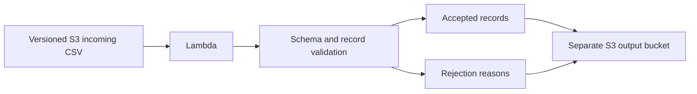

# AWS Notification Data Pipeline

A portfolio implementation inspired by my experience processing notification CSV data with AWS Lambda and Amazon S3. It validates incoming records, quarantines bad rows, and writes reproducible processing results. It processes notification data; it does not send email or SMS.

## Architecture



## Run locally

Python 3.12. From this repository directory:

```bash
python -m venv .venv
# Windows: .venv\Scripts\activate
# macOS/Linux: source .venv/bin/activate
python -m pip install -r requirements.txt
python demo.py
python -m unittest discover -s tests -v
```

Expected summary: `{"accepted": 2, "rejected": 2}`. Inspect `results/processed.json`. The sample uses synthetic addresses and device IDs. No AWS credentials are needed for the local demo or tests.

## Engineering decisions

- Required CSV columns and timezone-aware timestamps enforce an input contract.
- Duplicate notification IDs within a file are rejected. There is no global deduplication across separate files.
- The output key hashes source identity, object version, and content. A replay of the same version overwrites the same result instead of creating another output key. This is artifact idempotency, not exactly-once notification delivery.
- Object version IDs are read from S3 events so delayed events can process the intended version.
- Separate input and output buckets avoid recursive Lambda triggers. Logs contain counts rather than recipient/message contents.

## Optional AWS deployment

`template.yaml` supplies an AWS SAM template, checked with cfn-lint. Choose a unique `BucketPrefix` if deploying more than one stack in an account and region. With AWS CLI, SAM CLI, and your own AWS sandbox configured, run `sam build`, `sam validate --lint`, then `sam deploy --guided`. Upload the CSV under `incoming/` in the stack's input bucket. Check the output bucket and CloudWatch logs. This creates billable AWS resources. No cloud deployment has been performed as part of the local verification.

## Scope and next steps

The handler reads a complete file into memory and is intended for small demonstration files. Large files require chunking or a distributed job. Production delivery would add an outbox or queue, cross-file idempotency, encryption-key policy, retention rules, and asynchronous failure destinations. These additions are design extensions, not claims about my previous employer's implementation.

References: [AWS S3 event processing](https://docs.aws.amazon.com/lambda/latest/dg/with-s3.html).
